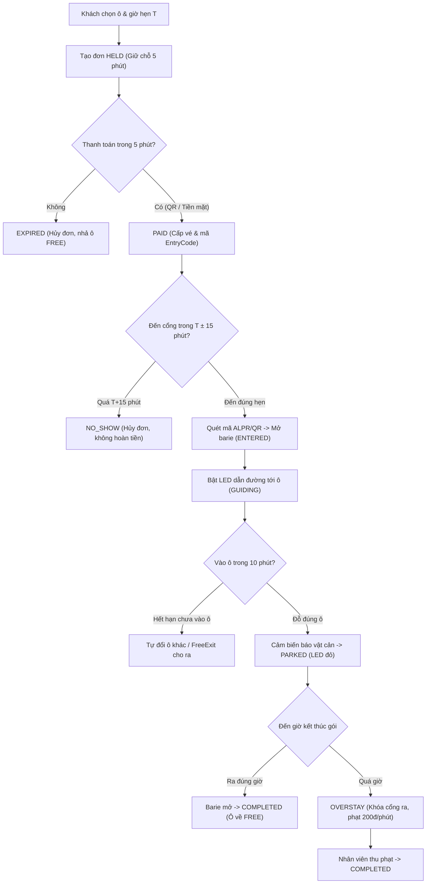

# BÁO CÁO TỔNG QUAN HỆ THỐNG SMART PARKING IOT

> **Dự án**: Hệ thống quản lý bãi đỗ xe thông minh kết hợp IoT & Đặt chỗ trực tuyến  
> **Ngôn ngữ**: C# ASP.NET Core 8.0, C++ Arduino ESP32, HTML5/CSS3/JavaScript  
> **Tài liệu**: Tổng quan kiến trúc nghiệp vụ, vòng đời trạng thái và tham số cấu hình

---

## 1. MỤC TIÊU VÀ PHẠM VI DỰ ÁN

### 1.1 Mục tiêu
- **Giải quyết bài toán ùn tắc và tìm kiếm chỗ đỗ**: Cho phép khách hàng tìm kiếm, đặt trước ô đỗ chính xác và thanh toán trực tuyến trước khi đến bãi, giảm thiểu 90% thời gian xe chạy vòng tìm chỗ.
- **Tự động hóa hoàn toàn luồng xe vào - ra**: Tích hợp thiết bị phần cứng IoT (barie servo, cảm biến siêu âm khoảng cách, dải LED dẫn đường NeoPixel, màn hình LCD I2C) tương tác thời gian thực với máy chủ qua giao thức MQTT.
- **Minh bạch hóa tài chính & Nghiệp vụ quản trị**: Ngăn ngừa tiêu cực, gian lận, hỗ trợ thanh toán đa kênh (chuyển khoản VietQR tự động, tiền mặt tại quầy cấp mã Crockford CashCode), kiểm soát chặt chẽ các trường hợp quá giờ (OVERSTAY) và đỗ chèn vạch (OVERLAP).

### 1.2 Phạm vi hệ thống
- **Quy mô bãi xe**: Thiết kế chuẩn 40 ô đỗ xe chia làm 5 hàng ($A, B, C, D, E$), mỗi hàng 8 ô.
  - **Hàng E (8 ô E1 - E8)**: Triển khai phần cứng thực nghiệm đầy đủ (board ESP32 `row_e`, 8 cảm biến siêu âm HC-SR04, dải LED RGB NeoPixel dẫn đường và hiển thị trạng thái ô).
  - **Hàng A, B, C, D (32 ô)**: Các hàng ô mô phỏng (virtual slots) hỗ trợ đầy đủ luồng đặt chỗ, phân phối tải và chỉ đường.
  - **Hệ thống cổng (Gate)**: Board ESP32 `esp32_gate` điều khiển servo barie Vào/Ra, cảm biến chùm tia hồng ngoại, màn hình LCD 1602 I2C và 3 nút bấm khẩn cấp.
- **Đối tượng người dùng**:
  - **Khách hàng (Customer)**: Ứng dụng Web PWA đặt chỗ, thanh toán trực tuyến, nhận vé QR code và bật đèn LED dẫn đường.
  - **Nhân viên trực cổng / Thu ngân (Staff)**: Bàn trực xử lý việc theo 4 cấp độ ưu tiên (thu phạt quá giờ, đổi ô/FreeExit khi kẹt xe, mở khóa mã bị khóa, thu tiền mặt cấp CashCode).
  - **Quản trị viên (Admin)**: Giám sát sơ đồ 40 ô thời gian thực, biểu đồ doanh thu SVG, tỷ lệ lấp đầy, quản lý 6 board vi điều khiển ESP32 và nhật ký hệ thống.

---

## 2. MÔ HÌNH NGHIỆP VỤ: ĐẶT CHỖ TRẢ TRƯỚC VÀ KHÁCH VÃNG LAI

Hệ thống hoạt động theo mô hình đặt chỗ theo khung giờ hẹn (Time-slotted Reservation Model) kết hợp tiếp nhận khách vãng lai thông minh:

---

## 3. BẢNG CHUYỂN TRẠNG THÁI VỊ TRÍ Ô ĐỖ XE (ViTriDoXe)

| Trạng thái ô | Màu LED | Ý nghĩa nghiệp vụ | Điều kiện chuyển tiếp tiếp theo |
|:---|:---:|:---|:---|
| `FREE` | Xanh lá | Ô đang trống, sẵn sàng tiếp nhận đặt chỗ hoặc xe vào | Chuyển `HELD` khi khách tạo đơn; hoặc `OCCUPIED` nếu xe vào trực tiếp |
| `HELD` | Vàng hổ phách | Ô đang được tạm giữ trong 5 phút chờ thanh toán | Chuyển `BOOKED` khi thanh toán xong; chuyển `FREE` nếu hết 5 phút |
| `BOOKED` | Xanh dương | Khách đã thanh toán, giữ chỗ cho khung giờ hiện tại | Chuyển `GUIDING` khi xe quét mã vào cổng; chuyển `FREE` nếu NO_SHOW |
| `BOOKED_FUTURE` | Tím nhạt | Ô đã được thanh toán cho một khung giờ trong tương lai | Giữ nguyên trạng thái để không bị đặt trùng, hiển thị cho khách biết |
| `GUIDING` | Xanh Cyan (Chớp) | Xe đã qua barie cổng vào, đèn dẫn đường đang sáng dẫn xe tới ô | Chuyển `OCCUPIED` khi xe đỗ vào ô; chuyển `FREE` nếu hủy hoặc đổi ô |
| `OCCUPIED` | Đỏ | Xe đang đỗ an toàn trong ô (khoảng cách cảm biến $< 100$ cm) | Chuyển `FREE` khi xe rời ô ($> 120$ cm) |
| `OVERLAP` | Vàng nhấp nháy | Xe đỗ lấn vạch giữa 2 ô liền kề (khoảng cách 2 bên $40-80$ cm) | Chuyển `OCCUPIED` hoặc `FREE` khi tài xế chỉnh lại xe chuẩn xác |
| `UNKNOWN` | Xám | Mất kết nối phần cứng với board ESP32 quản lý hàng ô đó (LWT) | Tự động phục hồi trạng thái cũ khi board gửi MQTT `ONLINE` trở lại |
| `MAINTENANCE` | Cam | Ô đỗ tạm đóng để bảo dưỡng kỹ thuật | Quản trị viên kích hoạt mở lại ô |

---

## 4. BẢNG CHUYỂN TRẠNG THÁI ĐƠN ĐẶT CHỖ (DonDatCho)

| Trạng thái đơn | Khung thời gian | Mô tả hành vi & Hệ quả tài chính |
|:---|:---:|:---|
| `DRAFT` | Tức thời | Đơn mới tạo trên giao diện người dùng, chưa gửi lưu máy chủ. |
| `PENDING_PAYMENT` | Tối đa 5 phút | Đang giữ ô, chờ webhook ngân hàng hoặc thu tiền mặt tại quầy. Hết 5 phút tự chuyển `EXPIRED`. |
| `PAID` | Từ thanh toán đến $T+15'$ | Đã thanh toán thành công, vé điện tử và mã EntryCode kích hoạt sẵn sàng check-in. |
| `ENTERED` | Tối đa 10 phút | Xe đã quét mã thành công qua barie cổng vào, đang trên lộ trình di chuyển tới ô đỗ. |
| `PARKED` | Suốt gói gửi (1-4h) | Xe đã đỗ đúng ô (cảm biến xác nhận). Đồng hồ đếm ngược thời lượng đỗ xe hoạt động. |
| `COMPLETED` | Kết thúc | Xe đã rời bãi an toàn qua cổng ra. Đơn kết thúc, giải phóng ô về `FREE`. |
| `EXPIRED` | Sau 5 phút giữ | Hết thời gian chờ thanh toán. Hủy đơn tự động, nhả ô cho khách hàng khác. |
| `NO_SHOW` | Sau $T+15'$ | Quá 15 phút giờ hẹn mà khách không đến quét mã. **Không hoàn tiền** đã thanh toán. |
| `ABANDONED` | Trong 10 phút vào | Xe đã vào cổng nhưng quay ra ngay mà không đỗ vào ô. Giải phóng ô về `FREE`. |
| `OVERSTAY` | Sau giờ kết thúc gói | Xe gửi quá thời gian đã mua. Barie cổng ra khóa chặn, tính phí phạt 200đ/phút. |
| `CANCELLED` | Trước giờ hẹn | Khách chủ động hủy đơn hợp lệ (nếu chính sách cho phép). |

---

## 5. BẢNG THAM SỐ CẤU HÌNH HỆ THỐNG (ParkingPolicySettings)

Toàn bộ các quy tắc thời gian và cước phí được quản lý tập trung qua `IOptionsMonitor<ParkingPolicySettings>` trong `backend/appsettings.json`, cho phép cập nhật nóng mà không cần khởi động lại máy chủ:

| Tên tham số cấu hình | Giá trị mặc định | Ý nghĩa & Tác động nghiệp vụ |
|:---|:---:|:---|
| `HoldDurationMin` | 5 phút | Thời gian tối đa giữ chỗ (`HELD`) chờ khách thanh toán. Quá hạn tự hủy. |
| `CheckInWindowMinutes` | 15 phút | Khoảng thời gian cho phép đến cổng quanh giờ hẹn $T$ ($[T-15, T+15]$). Quá $T+15$ tính `NO_SHOW`. |
| `TransitToSlotMinutes` | 10 phút | Thời gian tối đa từ lúc qua barie cổng vào tới lúc cảm biến nhận xe trong ô. |
| `JamExtendMinutes` | 5 phút | Thời gian được cộng thêm khi bấm nút "Tôi đang kẹt xe" hoặc kích hoạt Checkpoint. |
| `MaxJamExtends` | 1 lần | Số lần tối đa một đơn hàng được phép yêu cầu cứu nguy kẹt xe nội bộ. |
| `HourlyRate` | 20.000 VNĐ | Đơn giá gửi xe cơ bản cho 1 giờ. |
| `PenaltyPerMinute` | 200 VNĐ | Mức phạt phụ thu cho mỗi phút gửi xe quá hạn (`OVERSTAY`). |
| `MinGapBetweenBookingsMin` | 30 phút | Khoảng đệm an toàn bắt buộc giữa hai lượt đặt chỗ khác nhau trên cùng một vị trí ô. |
| `MaxInLotSearching` | 5 xe | Ngưỡng số xe tối đa đang tìm ô trong bãi (`ENTERED`). Vượt ngưỡng, barie cổng vào tạm `HOLD`. |
| `GateOpenDurationSec` | 10 giây | Thời gian servo barie mở tự động cho 1 lượt xe đi qua trước khi tự đóng lại. |
| `MaxFailedScanAttempts` | 3 lần | Số lần quét sai mã EntryCode tối đa tại barie trước khi mã tự động bị khóa (`LOCKED`). |
| `SensorOccupiedThresholdCm` | 100 cm | Ngưỡng khoảng cách cảm biến siêu âm xác nhận ô có xe đỗ ($< 100$ cm). |
| `SensorFreeThresholdCm` | 120 cm | Ngưỡng khoảng cách cảm biến xác nhận ô đã hoàn toàn trống xe ($> 120$ cm). |
| `OverlapMinCm` / `MaxCm` | 40 - 80 cm | Dải khoảng cách trên 2 ô liền kề xác định hiện tượng xe đỗ lấn vạch (`OVERLAP`). |
