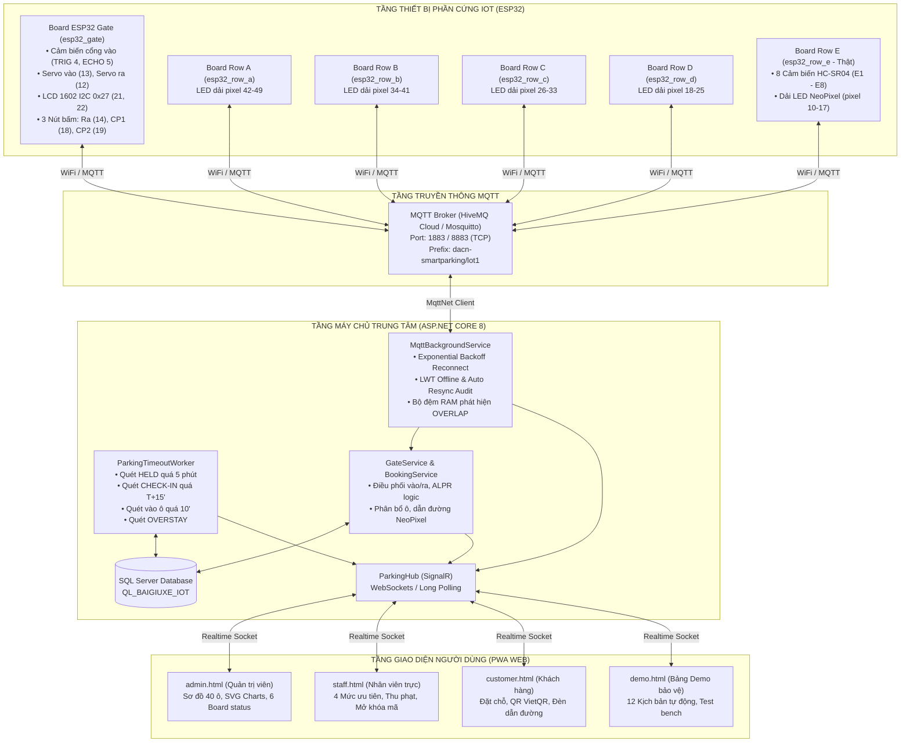
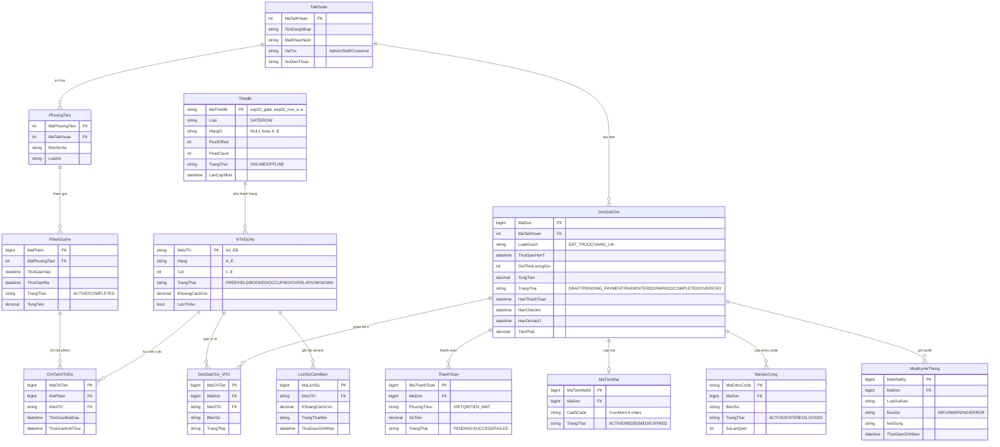

# KIẾN TRÚC HỆ THỐNG VÀ MÔ HÌNH DỮ LIỆU SMART PARKING IOT

> **Dự án**: Smart Parking IoT System Architecture & Data Model  
> **Phiên bản**: 2.5 (Kiến trúc phân tán đa vi điều khiển WiFi/MQTT)

---

## 1. SƠ ĐỒ KHỐI TỔNG THỂ HỆ THỐNG

Hệ thống được thiết kế theo mô hình phân tán 3 tầng (Phần cứng IoT - Máy chủ xử lý trung tâm - Ứng dụng người dùng), giao tiếp thông qua hai kênh truyền tải thời gian thực: **MQTT** cho tầng thiết bị và **SignalR WebSockets** cho tầng giao diện người dùng.

---

## 2. HỢP ĐỒNG DANH MỤC TOPIC MQTT

Toàn bộ thông điệp trao đổi giữa Backend và Firmware tuân thủ chặt chẽ tiền tố `{prefix} = dacn-smartparking/lot1`:

| STT | Topic MQTT | Publisher | Subscriber | Retain | Ý nghĩa & Cấu trúc Payload mẫu |
|:---:|:---|:---:|:---:|:---:|:---|
| 1 | `{prefix}/gate/in/event` | ESP32 Gate | Backend | `false` | Báo xe qua cảm biến cổng vào: `{"event":"PASS","transitSec":2.4}` |
| 2 | `{prefix}/gate/out/event` | ESP32 Gate | Backend | `false` | Báo xe bấm nút ra cổng: `{"event":"BUTTON_EXIT_PRESSED"}` |
| 3 | `{prefix}/gate/{in\|out}/cmd` | Backend | ESP32 Gate | `false` | Lệnh điều khiển servo barie: `{"cmd":"OPEN","gate":"IN","durationSec":10}` |
| 4 | `{prefix}/slot/{id}/state` | ESP32 Row | Backend | **`true`** | Trạng thái khoảng cách cảm biến: `{"spot":"E1","distanceCm":75.2}` |
| 5 | `{prefix}/slot/{id}/cmd` | Backend | ESP32 Row | `false` | Lệnh màu LED ô đỗ: `"GREEN"`, `"RED"`, `"YELLOW"`, `"BLUE"`, `"OFF"` |
| 6 | `{prefix}/guide/cmd` | Backend | ESP32 (All) | `false` | Dẫn đường NeoPixel: `{"targetSlot":"E7","pixels":[0,1,10,11,16]}` |
| 7 | `{prefix}/display/cmd` | Backend | ESP32 Gate | `false` | Hiển thị chữ lên màn hình LCD: `{"line1":"CHAO MUNG","line2":"O DO: E7"}` |
| 8 | `{prefix}/device/{id}/status` | ESP32 / LWT | Backend | **`true`** | Trạng thái sống còn: `"ONLINE"` hoặc LWT `"OFFLINE"` |
| 9 | `{prefix}/device/{id}/power` | Simulator / Demo | Backend | **`true`** | Trạng thái nguồn điện của board: `"ONLINE"` hoặc `"OFFLINE"` |
| 10 | `{prefix}/device/{id}/cmd` | Backend | ESP32 Node | `false` | Lệnh gửi tới thiết bị: `{"cmd":"RESYNC"}` |
| 11 | `{prefix}/checkpoint/{id}/event` | ESP32 Gate | Backend | `false` | Nút bấm trạm dẫn đường: `{"event":"CHECKPOINT_TRIGGERED","cp":"CP1"}` |
| 12 | `{prefix}/alert` | Backend / ESP32 | Các bên | `false` | Cảnh báo sự cố: `{"event":"UNAUTHORIZED_ENTRY","message":"..."}` |
| 13 | `{prefix}/ack` | Backend | ESP32 Node | `false` | Phản hồi xác nhận: `{"topic":"...","status":"SUCCESS"}` |
| 14 | `{prefix}/summary` | Backend | Dashboard | **`true`** | Tổng quan bãi: `{"total":40,"free":35,"occupied":5}` |

---

## 3. MÔ HÌNH THỰC THỂ LIÊN KẾT (ERD 13 BẢNG CƠ SỞ DỮ LIỆU)

---

## 4. LÝ DO CHỌN GIẢI PHÁP KHÔNG DÂY WIFI & GIAO THỨC MQTT

1. **Loại bỏ dây tín hiệu vật lý phức tạp (No Bus Wiring)**:
   - Trong bãi đỗ xe diện tích lớn từ hàng trăm đến hàng nghìn mét vuông, việc chạy dây truyền thông nối tiếp (RS-485, CAN bus, Modbus RTU) hoặc kéo cáp mạng Ethernet đòi hỏi đục đẽo sàn bê tông, tốn kém chi phí bảo trì và dễ bị đứt ngầm khi xe có tải trọng lớn đi qua.
   - WiFi kết hợp MQTT cho phép mỗi hàng ô chỉ cần cấp nguồn độc lập ($5V/2A$), các board vi điều khiển ESP32 hoàn toàn tự do lắp đặt và tự kết nối vào mạng không dây.
2. **Cơ chế Pub/Sub Decoupled (Bất đồng bộ & Mở rộng linh hoạt)**:
   - Các vi điều khiển không cần biết địa chỉ IP của nhau hoặc của Backend. Khi muốn thêm hàng ô mới (Row F, Row G...), chỉ việc flash firmware cấu hình `NODE_ROLE` tương ứng mà không phải sửa một dòng mã nguồn nào của các board khác hay khởi động lại Backend.
3. **Cơ chế LWT (Last Will and Testament) phát hiện mất điện tức thời**:
   - Khác với HTTP REST cần thăm dò (polling) liên tục gây quá tải mạng, MQTT tích hợp sẵn bản tin LWT do Broker tự động phát ra ngay khi ESP32 mất kết nối hoặc mất nguồn đột ngột. Backend lập tức đánh dấu các ô thuộc hàng đó sang `UNKNOWN`, bảo vệ tính nhất quán dữ liệu.
4. **Bản tin Retained giữ trạng thái bền vững**:
   - Trạng thái ô (`slot/{id}/state`) và trạng thái thiết bị (`device/{id}/status`) được lưu lại bản sao mới nhất trên Broker. Thiết bị hoặc Backend sau khi khởi động lại chỉ cần subscribe là ngay lập tức nhận được trạng thái toàn bãi mà không cần quét lại từ đầu.

---

## 5. CÁC GIỚI HẠN CỦA MÔ HÌNH VÀ HƯỚNG PHÁT TRIỂN

| Hạng mục | Hiện trạng mô hình thực nghiệm | Lý do thiết kế & Giải pháp thực tế khi triển khai thương mại |
|:---|:---|:---|
| **Hàng ô ảo (A, B, C, D)** | 32 ô hàng A-D là ô ảo trên phần mềm, chỉ hàng E có cảm biến thật. | Tối ưu chi phí thực nghiệm đồ án; kiến trúc code đã tách biệt theo 6 env PlatformIO và sẵn sàng nạp thẳng vào 5 board ESP32 phần cứng bổ sung. |
| **Nhận diện biển số (ALPR)** | Mô phỏng qua nút bấm & API `/api/gate/in/scan` (so khớp biển số quét mã với biển số đăng ký). | Thực tế sẽ kết nối Camera IP RTSP và module AI OCR (như OpenCV / Yolov8 / ANPR Cloud) để tự động nhận dạng chuỗi biển số. |
| **Thanh toán ngân hàng** | Mô phỏng webhook ngân hàng qua API Demo `/simulate-success`. | Thực tế sẽ kết nối cổng thanh toán thật (VNPay / MoMo / PayOS / VietQR Open API) có chữ ký số HMAC-SHA256 chuẩn bảo mật ngân hàng. |
| **MQTT Broker** | Sử dụng Broker công cộng `broker.hivemq.com:1883`. | Phục vụ demo không cần cài broker local; khi lên môi trường Production sẽ chạy cụm EMQX / Eclipse Mosquitto nội bộ có xác thực TLS/MQTTS và User/Password. |
