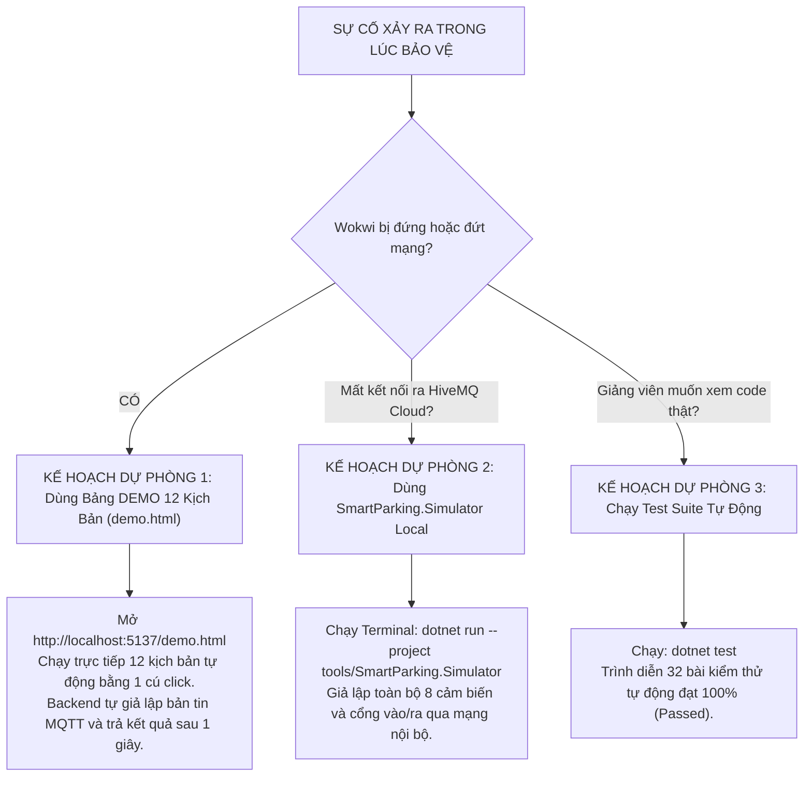

# KỊCH BẢN DEMO BẢO VỆ ĐỒ ÁN 10 PHÚT VÀ KẾ HOẠCH DỰ PHÒNG

> **Mục tiêu**: Hướng dẫn chi tiết từng bước trình diễn hệ thống trước hội đồng phản biện trong 10 phút, tạo ấn tượng mạnh về tính hoàn thiện và khả năng xử lý sự cố thực tế.

---

## 1. CHUẨN BỊ MÔI TRƯỜNG TRƯỚC BUỔI BẢO VỆ (0 - 5 PHÚT TRƯỚC GIỜ G)

### 1.1 Khởi động các dịch vụ
1. Mở **Visual Studio 2022** hoặc terminal chạy Backend:
   ```powershell
   cd E:\IOT\IOTCODE\IOT_SmartParking
   dotnet run --project backend\SmartParking.Api.csproj
   ```
   *Kiểm tra*: Dòng log hiển thị `Now listening on: http://localhost:5137`.
2. Mở trình duyệt Chrome ở chế độ chia màn hình (Split screen):
   - **Nửa màn hình trái**: Mở trang Quản trị `http://localhost:5137/admin.html` (đã có sẵn biểu đồ SVG và sơ đồ 40 ô).
   - **Nửa màn hình phải**: Mở 2 tab:
     + Tab 1: `http://localhost:5137/customer.html` (Khách hàng đặt chỗ).
     + Tab 2: `http://localhost:5137/staff.html` (Bàn trực nhân viên).
3. Mở **Wokwi Simulation** trong VS Code hoặc trên trình duyệt:
   - Chạy board `wokwi/gate` (Cổng vào/ra, LCD, Servo, 3 nút bấm).
   - Chạy board `wokwi/row_e` (Hàng E, 8 cảm biến siêu âm, dải LED NeoPixel).

---

## 2. KỊCH BẢN TRÌNH DIỄN 10 PHÚT TỪNG BƯỚC

| Thời gian | Trang / Cửa sổ | Thao tác trình diễn | Kết quả hiển thị mong đợi | Lời thuyết minh với Giảng viên |
|:---:|:---|:---|:---|:---|
| **00:00 - 01:30** | `admin.html` | Giới thiệu tổng quan bãi 40 ô, xem biểu đồ doanh thu SVG, tỷ lệ lấp đầy và trạng thái 6 board vi điều khiển ESP32. | Sơ đồ 40 ô hiển thị trực quan; 6 board ESP32 báo `ONLINE` với đúng dải pixel. | "Kính thưa hội đồng, hệ thống gồm 40 ô chia làm 5 hàng, quản lý bởi 6 board vi điều khiển ESP32 độc lập không dây qua WiFi và MQTT." |
| **01:30 - 03:30** | `customer.html` | Chọn ô **E7**, chọn gói 1 giờ ($20.000$ đ), nhập biển số `51H-999.88`. Bấm **Giữ chỗ ngay**. | Ô E7 trên `admin.html` lập tức đổi sang màu vàng `HELD`. Đồng hồ đếm ngược 5 phút kích hoạt trên điện thoại. | "Khách giữ chỗ thành công. Ô chuyển `HELD`, hệ thống giữ chỗ trong 5 phút. Nếu không thanh toán sẽ tự hủy để tránh chiếm chỗ ảo." |
| **03:30 - 04:30** | `customer.html` | Bấm nút **Tôi đã chuyển khoản (Mô phỏng thanh toán)**. | Đơn chuyển sang `PAID`, ô E7 chuyển màu xanh dương `BOOKED`. Khách nhận được vé có mã QR EntryCode. | "Thanh toán thành công. Khách nhận vé điện tử kèm mã QR bảo mật để chuẩn bị check-in tại cổng." |
| **04:30 - 06:00** | Wokwi `gate` & `admin.html` | Mô phỏng quét mã vào cổng: Gọi API quét mã hoặc kéo cảm biến cổng vào `sensor_gate_in`. | Servo cổng vào quay $90^\circ$ mở barie. Màn hình LCD hiện `CHAO MUNG O DO: E7`. Dải LED NeoPixel bật sáng dẫn đường màu Cyan. Đơn chuyển `ENTERED`. | "Tại cổng vào, mã QR được đối soát hợp lệ, barie tự động mở 10s. Màn hình LCD hướng dẫn ô đỗ và dải LED NeoPixel sáng dẫn đường tới ô E7." |
| **06:00 - 07:30** | Wokwi `row_e` | Kéo thanh trượt cảm biến `sensor_e7` từ $200\text{ cm}$ xuống $60\text{ cm}$ (xe đã đỗ vào ô). | Đèn LED ô E7 đổi sang màu **ĐỎ** (`OCCUPIED`). Trên `admin.html` ô E7 chuyển đỏ. Trên `customer.html` chuyển sang đếm ngược thời gian đỗ. | "Cảm biến siêu âm ghi nhận xe đã vào ô an toàn. Đèn chuyển sang màu đỏ báo bận, tránh các xe khác đi nhầm vào." |
| **07:30 - 09:00** | `staff.html` & `demo.html` | **Trình diễn kịch bản đỗ lấn vạch (OVERLAP)**: Kéo cả E1 và E2 về mức $60\text{ cm}$. | Đèn LED của cả 2 ô E1 và E2 chớp **VÀNG**. Bàn trực nhân viên `staff.html` và `admin.html` bật cảnh báo đỗ lấn vạch thời gian thực. | "Hệ thống tự động phát hiện xe đỗ chèn vạch giữa 2 ô nhờ dải khoảng cách $40-80$ cm trên 2 cảm biến, cảnh báo nhân viên xử lý tức thời." |
| **09:00 - 10:00** | `staff.html` | **Trình diễn kịch bản quá giờ (OVERSTAY)**: Bấm kịch bản 10. | Barie cổng ra khóa chặn xe quá giờ, hệ thống tính tiền phạt 200đ/phút. Nhân viên thu tiền và bấm xác nhận, barie ra lập tức mở. | "Trường hợp đỗ quá giờ, barie ra chặn lại và tính phí phạt minh bạch. Nhân viên thu phạt xong cổng mới mở ra." |

---

## 3. KẾ HOẠCH DỰ PHÒNG (CONTINGENCY PLAN KHI MẠNG HOẶC WOKWI GẶP SỰ CỐ)

Khi bảo vệ đồ án, mạng WiFi hội trường có thể bị chập chờn hoặc Broker công cộng HiveMQ bị nghẽn gói. Áp dụng quy trình dự phòng 3 cấp độ:



### 3.1 Hướng dẫn kích hoạt Kế hoạch Dự phòng 1 (`demo.html`)
1. Trên trình duyệt, bấm vào nút **"⚙️ Bảng DEMO"** ở góc phải thanh điều hướng `admin.html` (hoặc mở `http://localhost:5137/demo.html`).
2. Tại đây có sẵn danh sách 12 nút kịch bản nghiệp vụ:
   - Bấm **"Chạy kịch bản 1"**: Giả lập 2 khách đặt trùng ô cùng lúc $\rightarrow$ Hiện thông báo từ chối người thứ 2.
   - Bấm **"Chạy kịch bản 8"**: Giả lập đỗ lấn vạch OVERLAP $\rightarrow$ Hiện đèn vàng nhấp nháy.
   - Bấm **"Chạy kịch bản 10"**: Giả lập đỗ quá giờ OVERSTAY $\rightarrow$ Hiện phí phạt 3.000 VNĐ.
3. Giải thích với giảng viên: *"Thưa thầy, bảng DEMO này chạy trực tiếp trên Backend và Database thật, mô phỏng đúng các bản tin MQTT mà vi điều khiển phát lên."*
