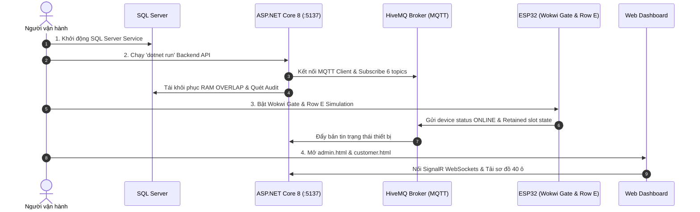

# HƯỚNG DẪN CÀI ĐẶT, VẬN HÀNH VÀ XỬ LÝ SỰ CỐ SMART PARKING IOT

> **Tài liệu**: Hướng dẫn triển khai dự án từ máy tính trắng (Clean Setup), thứ tự khởi động và bảng tổng hợp cách khắc phục 6 sự cố kỹ thuật thường gặp.

---

## 1. YÊU CẦU MÔI TRƯỜNG VÀ CÔNG CỤ CẦN THIẾT

1. **Hệ điều hành**: Windows 10/11 (hoặc Ubuntu 22.04 LTS / macOS).
2. **Cơ sở dữ liệu**: Microsoft SQL Server 2019/2022 hoặc **SQL Server Express** (`.\SQLEXPRESS`).
3. **Môi trường .NET**: .NET SDK 8.0 trở lên (`dotnet --version` hiển thị `8.0.x`).
4. **Môi trường Firmware**: Python 3.10+ và **PlatformIO Core (CLI)** (`pio`).
5. **Môi trường Mô phỏng**: Tiện ích mở rộng **Wokwi for VS Code** (hoặc tài khoản Wokwi Web).
6. **Công cụ dòng lệnh**: `sqlcmd`, `curl` hoặc `PowerShell`.

---

## 2. QUY TRÌNH CÀI ĐẶT TỪ ĐẦU (CLEAN SETUP)

### Bước 1: Khởi tạo Cơ sở Dữ liệu SQL Server
Mở PowerShell tại thư mục gốc dự án và chạy script khởi tạo:
```powershell
cd E:\IOT\IOTCODE\IOT_SmartParking
sqlcmd -S .\SQLEXPRESS -E -i QL_BAIGIUXE_IOT.sql
```
*Ghi chú*: Script được thiết kế an toàn có tính chất **Idempotent** (chạy lại nhiều lần không lỗi), tự động tạo 13 bảng và nạp 40 ô đỗ xe kèm 6 bản ghi thiết bị `ThietBi`.

### Bước 2: Cấu hình Chuỗi Kết Nối & User-Secrets
Cấu hình chuỗi kết nối trong file `backend/appsettings.json` hoặc lưu vào `.NET user-secrets`:
```powershell
cd backend
dotnet user-secrets set "ConnectionStrings:DefaultConnection" "Server=.\\SQLEXPRESS;Database=QL_BAIGIUXE_IOT;Trusted_Connection=True;TrustServerCertificate=True;MultipleActiveResultSets=true"
dotnet user-secrets set "Mqtt:Broker" "broker.hivemq.com"
dotnet user-secrets set "Mqtt:Port" "1883"
dotnet user-secrets set "Mqtt:TopicPrefix" "dacn-smartparking/lot1"
```

### Bước 3: Biên dịch Firmware ESP32 cho cả 6 Board
Sử dụng PlatformIO để biên dịch firmware cho cả 6 vai trò:
```powershell
cd E:\IOT\IOTCODE\IOT_SmartParking
& C:\Users\dth06\.platformio\penv\Scripts\pio.exe run
```
Sau khi biên dịch thành công, chép file nhị phân vào thư mục Wokwi:
```powershell
Copy-Item -Path .pio\build\gate\firmware.bin -Destination wokwi\gate\firmware.bin -Force
Copy-Item -Path .pio\build\gate\firmware.elf -Destination wokwi\gate\firmware.elf -Force
Copy-Item -Path .pio\build\row_e\firmware.bin -Destination wokwi\row_e\firmware.bin -Force
Copy-Item -Path .pio\build\row_e\firmware.elf -Destination wokwi\row_e\firmware.elf -Force
```

---

## 3. THỨ TỰ KHỞI ĐỘNG HỆ THỐNG

Để các thành phần nhận diện nhau trơn tru, luôn tuân thủ thứ tự 3 bước sau:



Lệnh chạy Backend:
```powershell
cd E:\IOT\IOTCODE\IOT_SmartParking\backend
dotnet run
```
Mở trình duyệt: `http://localhost:5137/admin.html`

---

## 4. BẢNG XỬ LÝ 6 SỰ CỐ PHỔ BIẾN ĐÃ TỪNG GẶP

| STT | Hiện tượng sự cố | Nguyên nhân gốc rễ | Cách khắc phục triệt để |
|:---:|:---|:---|:---|
| **1** | **Cổng 5137 bị bận (Port already in use)** | Có một tiến trình `dotnet` cũ đang chạy ngầm trong background chiếm dụng cổng HTTP 5137. | Chạy lệnh tìm và tắt tiến trình cũ:<br>`Get-Process -Name SmartParking.Api -ErrorAction SilentlyContinue \| Stop-Process -Force`<br>hoặc tìm cổng: `Get-NetTCPConnection -LocalPort 5137 \| Select-Object OwningProcess` rồi kill PID. |
| **2** | **sqlcmd báo lỗi không kết nối được instance** | Máy tính cài đặt SQL Server phiên bản đầy đủ (`(local)` / `localhost`) hoặc tên instance khác với `.\SQLEXPRESS`. | Kiểm tra tên service SQL Server trong Services (`services.msc`), chạy lệnh test:<br>`sqlcmd -S "localhost" -Q "SELECT @@VERSION;"`<br>hoặc đổi `-S .\SQLEXPRESS` thành `-S (localdb)\mssqllocaldb`. |
| **3** | **Wokwi báo lỗi đường dẫn firmware trong wokwi.toml** | File `wokwi.toml` trỏ tới đường dẫn tương đối sai khi mở VS Code từ thư mục con. | Mở `wokwi/gate/wokwi.toml` và `wokwi/row_e/wokwi.toml`. Đảm bảo trỏ đúng: `elf = "firmware.elf"` và `bin = "firmware.bin"`, đồng thời đã chép file `.bin`/`.elf` mới nhất vào cùng thư mục đó. |
| **4** | **Firmware nạp vào Wokwi nhưng LCD trắng xóa, Serial không in chữ** | Chưa cấu hình cờ `-DNODE_ROLE=ROLE_GATE` khi build, hoặc chân I2C SDA/SCL bị lệch. | Biên dịch đúng môi trường `pio run -e gate` (có định nghĩa `-DNODE_ID=\"esp32_gate\" -DNODE_ROLE=ROLE_GATE`). Đảm bảo LCD I2C kết nối chân 21 (SDA), 22 (SCL) và địa chỉ I2C là `0x27`. |
| **5** | **Ô đỗ bị kẹt màu lạ do tin Retained cũ trên Broker** | Trước đây publish lệnh `slot/E*/cmd` với cờ `retain: true`, Broker HiveMQ lưu lại tin cũ và phát lại khi board bật lên. | Chạy script dọn sạch retained do hệ thống cung cấp:<br>`python tools/clean_retained_mqtt.py`<br>Script sẽ publish payload rỗng (`payload=""`, `retain=True`) để xóa sạch các topic rác trên HiveMQ. |
| **6** | **Giao diện Web báo "Mất kết nối" SignalR sau khi sleep** | Máy tính tắt màn hình hoặc ngắt mạng tạm thời, WebSocket bị đóng. | Giao diện đã được tích hợp `withAutomaticReconnect([0, 1000, 2000, 5000, 10000, 30000])`. Nếu không tự nối, chỉ cần bấm nút **"🔄 Đồng bộ lại"** trên thanh tiêu đề để thiết lập lại kết nối và tải lại toàn bộ sơ đồ ô từ API. |
