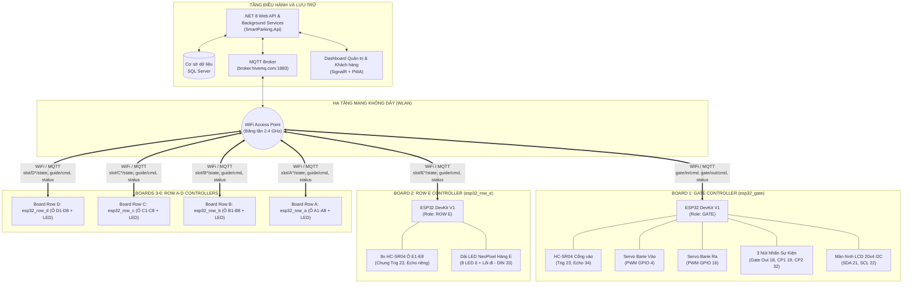

# BÁO CÁO THIẾT KẾ KIẾN TRÚC PHẦN CỨNG PHÂN TÁN (DISTRIBUTED HARDWARE ARCHITECTURE)

> **Hệ thống Quản lý Bãi đỗ xe Thông minh (Smart Parking IoT)**  
> **Kiến trúc**: Phân tán hoàn toàn (Multi-Board Distributed Architecture) gồm **6 Vi điều khiển ESP32** kết nối không dây qua **WiFi / MQTT**.

---

## 1. TỔNG QUAN KIẾN TRÚC PHÂN TÁN

Trong các bãi đỗ xe thương mại quy mô vừa và lớn (40 ô đỗ trở lên, phân bố thành nhiều dãy), việc sử dụng một vi điều khiển tập trung duy nhất kéo dây về từng cảm biến ô gặp phải nhiều nhược điểm nghiêm trọng:
1. **Suy hao và nhiễu tín hiệu**: Đường dây xung siêu âm (TRIG/ECHO) kéo dài hàng chục mét qua các kết cấu kim loại và động cơ ô tô gây méo dạng sóng và đo sai cự ly.
2. **Thiếu hụt chân GPIO**: Một ESP32 tiêu chuẩn chỉ có khoảng 18 chân GPIO khả dụng, không thể đáp ứng trực tiếp cho hàng chục cảm biến và thiết bị ngoại vi.
3. **Chi phí và rủi ro thi công**: Việc kéo hàng trăm mét cáp tín hiệu đi dọc trần bãi đỗ làm tăng chi phí vật tư, nhân công và rủi ro đứt cáp làm tê liệt toàn bộ hệ thống.

**Giải pháp của đồ án**: Chuyển đổi sang **Kiến trúc Phân tán Đa Board (Distributed Multi-Node Architecture)**:
- Mỗi dãy ô đỗ (Row) được quản lý độc lập bởi một vi điều khiển **ESP32 Hàng (Row Node)** lắp đặt ngay tại đầu mỗi dãy.
- Khu vực cổng kiểm soát được quản lý bởi một vi điều khiển **ESP32 Cổng (Gate Node)**.
- **Hoàn toàn không có đường dây tín hiệu cứng giữa các board**: Mọi thông điệp điều khiển, sự kiện cảm biến và dữ liệu trạng thái được truyền nhận thời gian thực qua sóng **WiFi** và giao thức **MQTT (Message Queuing Telemetry Transport)**.

---

## 2. SƠ ĐỒ KHỐI KIẾN TRÚC HỆ THỐNG (MERMAID)



---

## 3. BẢNG TỔNG HỢP 6 BOARD ESP32 TRONG TOÀN HỆ THỐNG

| STT | Tên Node / Roster | Node ID | Vai trò phần cứng | Đối tượng quản lý | Số GPIO | Pixel Offset / Count | Trạng thái triển khai |
|:---:|---|---|---|---|:---:|:---:|---|
| **1** | **Board Cổng** | `esp32_gate` | Điều khiển vào/ra, hiển thị trạm cổng | 2 Barie Servo, 1 HC-SR04, 3 Nút (GateOut, CP1, CP2), 1 LCD 20x4 I2C | **9** | 0 / 0 | **Mô phỏng Wokwi thật** (`wokwi/gate`) |
| **2** | **Board Hàng E** | `esp32_row_e` | Giám sát & chỉ dẫn đỗ dãy E | 8 Cảm biến HC-SR04 (E1-E8), dải LED NeoPixel hàng E | **10** | 10 / 8 | **Mô phỏng Wokwi thật** (`wokwi/row_e`) |
| **3** | **Board Hàng D** | `esp32_row_d` | Giám sát & chỉ dẫn đỗ dãy D | 8 Cảm biến HC-SR04 (D1-D8), dải LED NeoPixel hàng D | **10** | 18 / 8 | Đã build firmware, mô phỏng qua Web/CLI |
| **4** | **Board Hàng C** | `esp32_row_c` | Giám sát & chỉ dẫn đỗ dãy C | 8 Cảm biến HC-SR04 (C1-C8), dải LED NeoPixel hàng C | **10** | 26 / 8 | Đã build firmware, mô phỏng qua Web/CLI |
| **5** | **Board Hàng B** | `esp32_row_b` | Giám sát & chỉ dẫn đỗ dãy B | 8 Cảm biến HC-SR04 (B1-B8), dải LED NeoPixel hàng B | **10** | 34 / 8 | Đã build firmware, mô phỏng qua Web/CLI |
| **6** | **Board Hàng A** | `esp32_row_a` | Giám sát & chỉ dẫn đỗ dãy A | 8 Cảm biến HC-SR04 (A1-A8), dải LED NeoPixel hàng A | **10** | 42 / 8 | Đã build firmware, mô phỏng qua Web/CLI |

---

## 4. LÝ DO LỰA CHỌN MẠNG KHÔNG DÂY WIFI & GIAO THỨC MQTT

1. **Loại bỏ hoàn toàn hệ thống dây dẫn liên board**:
   - Khoảng cách giữa các dãy đỗ và trạm cổng trong bãi xe có thể từ 20m đến hơn 80m. Việc triển khai WiFi loại bỏ nhu cầu đào rãnh sàn hoặc treo máng cáp liên dãy.
2. **Khả năng cách ly sự cố (Fault Isolation)**:
   - Nếu một board hàng (ví dụ `esp32_row_e`) gặp sự cố mất nguồn hoặc hỏng phần cứng, broker MQTT sẽ kích hoạt LWT gửi `OFFLINE`. Backend chỉ cô lập hàng E thành `UNKNOWN`, trong khi **toàn bộ 32 ô còn lại và trạm cổng vẫn hoạt động bình thường**.
   - Khác hoàn toàn với kiến trúc bus nối tiếp có dây (nếu chập bus thì toàn bãi tê liệt).
3. **Cơ chế Publish/Subscribe linh hoạt và định tuyến thông minh**:
   - Backend chỉ cần phát một bản tin `guide/cmd` duy nhất. Các board hàng tự lọc theo `PIXEL_OFFSET` và `PIXEL_COUNT` mà không cần backend phải biết chi tiết cấu trúc chân của từng board.
4. **Chuẩn hóa công nghiệp và tương thích Cloud**:
   - Giao thức MQTT là tiêu chuẩn mở cho IoT, tương thích tự nhiên với các nền tảng Cloud, Dashboard Web thời gian thực và các ứng dụng di động.

---

## 5. SO SÁNH TOÀN DIỆN VỚI CÁC GIAO THỨC TRUYỀN THÔNG KHÁC

| Tiêu chí so sánh | **WiFi / MQTT** *(Lựa chọn đồ án)* | **RS-485 / Modbus RTU** | **CAN Bus** | **LoRa / LoRaWAN** | **ESP-NOW** |
|---|---|---|---|---|---|
| **Phương thức truyền dẫn** | **Không dây (2.4 GHz)** | Dây xoắn đôi (Twisted Pair) | Cáp 2 dây CAN_H, CAN_L | Không dây tần số Sub-GHz (433/915 MHz) | Không dây độc quyền Espressif (2.4 GHz) |
| **Băng thông / Tốc độ** | **Rất cao (lên đến 72 Mbps)** | Trung bình (9.6k - 115.2 kbps) | Cao (125 kbps - 1 Mbps) | Rất thấp (0.3 - 50 kbps) | Trung bình (~1 Mbps) |
| **Độ phức tạp đi dây** | **Không có dây liên board** (Chỉ cấp nguồn DC) | Cần đi dây bus nối tiếp qua tất cả các điểm | Cần đi cáp bus và lắp 2 trở đầu cuối $120\Omega$ | Không có dây | Không có dây |
| **Rủi ro đứt đường truyền** | **Cực thấp** (Sự cố một node không ảnh hưởng node khác) | **Cao** (Đứt dây trục chính làm đứt nửa sau mạng) | **Trung bình-Cao** (Lỗi bus làm tê liệt toàn mạng) | Cực thấp | Cực thấp |
| **Chi phí phần cứng phụ** | **0 VNĐ** (ESP32 tích hợp sẵn WiFi MAC/PHY) | Cần thêm IC chuyển đổi MAX485 cho mỗi board | Cần thêm module thu phát MCP2515/SN65HVD230 | Cần thêm module SX1278 (khá đắt tiền) | **0 VNĐ** (Dùng phần cứng WiFi nội) |
| **Độ trễ thời gian thực** | **Rất nhỏ (< 50 - 100 ms)** | Nhỏ (< 100 ms) | Cực nhỏ (< 10 ms) | Lớn (1 - 5 giây, do Duty Cycle) | Nhỏ (< 20 ms) |
| **Khả năng tích hợp Web** | **Trực tiếp qua Broker / WebSocket** | Phải có Gateway trung gian sang TCP/IP | Phải có Gateway CAN-to-Ethernet | Phải qua LoRa Gateway & Network Server | Phải có 1 ESP32 Master làm Gateway MQTT |
| **Khả năng mở rộng (Scalability)**| **Rất cao**: Cắm thêm board mới là tự hòa mạng | Hạn chế: Giới hạn tối đa 32/128 node trên 1 phân đoạn | Giới hạn số ID thông điệp trên bus | Rất cao | Giới hạn 20 peer kết nối trực tiếp |

> [!NOTE]
> **Kết luận**: **WiFi / MQTT** là giải pháp tối ưu nhất cho đồ án Smart Parking vì:
> 1. Không phát sinh chi phí phần cứng giao tiếp phụ (tận dụng RF nội của ESP32).
> 2. Đạt độ trễ thấp phù hợp cho phản hồi cảm biến và điều khiển barie tức thì.
> 3. Tương thích trực tiếp với hệ sinh thái Web Dashboard (.NET SignalR) mà không cần chế tạo thêm phần cứng Gateway phức tạp.

---

## 6. VẤN ĐỀ TƯƠNG THÍCH MỨC ĐIỆN ÁP (LEVEL SHIFTING 5V $\leftrightarrow$ 3.3V)

Vi điều khiển ESP32 chạy ở mức điện áp logic **3.3V**, trong khi cảm biến siêu âm HC-SR04 và dải LED WS2812B thường hoạt động tối ưu ở **5.0V**. Dưới đây là thiết kế mạch ghép nối chi tiết cho phần cứng thực tế:

### A. Tín hiệu đầu vào từ cảm biến (HC-SR04 ECHO $\rightarrow$ ESP32 GPIO)
- Xung `ECHO` từ HC-SR04 phát ra điện áp $5V$. Nếu nối trực tiếp vào ESP32 sẽ gây quá áp và làm hỏng cổng I/O sau một thời gian hoạt động.
- **Mạch cầu phân áp điện trở tiêu chuẩn**:
  ```text
  HC-SR04 (ECHO 5V)
         │
        [R1: 1.0 kΩ]
         │
         ├───> GPIO ESP32 (Điện áp xấp xỉ 3.33V - Cực kỳ an toàn)
         │
        [R2: 2.0 kΩ]
         │
        GND
  ```
  Công thức:
  $$V_{out} = V_{in} \times \frac{R_2}{R_1 + R_2} = 5.0V \times \frac{2000}{1000 + 2000} \approx 3.33V$$
- Đối với 8 cảm biến ô trên board hàng, có thể thay thế 8 cặp điện trở bằng 1 IC chuyển mức logic đa kênh chuyên dụng **TXS0108E** (8-channel bidirectional logic level shifter).

### B. Tín hiệu điều khiển dải LED (ESP32 GPIO 33 $\rightarrow$ NeoPixel DIN 5V)
- Tín hiệu xung từ GPIO 33 của ESP32 có biên độ $3.3V$. Chuẩn WS2812B yêu cầu mức logic High tối thiểu là $0.7 \times V_{CC} = 0.7 \times 5V = 3.5V$.
- Mặc dù trên khoảng cách ngắn (< 20cm) LED vẫn có thể nhận xung 3.3V, nhưng để đảm bảo độ tin cậy tuyệt đối không bị chớp giật trên mạch thật:
  - Sử dụng IC đệm mức logic tốc độ cao **74AHCT125** hoặc **TXS0108E** để nâng biên độ xung từ $3.3V$ lên đúng $5.0V$ cấp vào chân `DIN` của dải NeoPixel.

---

## 7. CÁC GIỚI HẠN KỸ THUẬT VÀ HƯỚNG PHÁT TRIỂN

Mặc dù kiến trúc WiFi/MQTT đem lại sự linh hoạt vượt trội, hệ thống vẫn có một số giới hạn cần lưu ý khi ứng dụng vào công trình thực tế:
1. **Suy hao sóng WiFi trong bãi đỗ xe ngầm (Tầng hầm B1/B2)**:
   - Các cột bê tông cốt thép dày đặc có thể gây điểm chết sóng (Dead zones).
   - *Hướng giải quyết*: Bố trí các bộ phát sóng phụ (WiFi Access Points hoặc Repeater công nghiệp chuẩn PoE) phân bổ đều theo từng cụm 2-3 dãy đỗ xe.
2. **Nguồn cấp và Dự phòng sự cố mất điện lưới**:
   - Khi mất điện, nếu không có nguồn dự phòng, các node cảm biến sẽ tắt.
   - *Hướng giải quyết*: Trang bị một mạch sạc pin Lithium 18650 tích hợp (UPS mini 5V/2A) cho mỗi board ESP32, đảm bảo hệ thống có thể duy trì hoạt động cảnh báo thêm 2-4 tiếng khi nguồn lưới bị gián đoạn.
3. **Bảo mật mạng không dây**:
   - Trong môi trường thực tế, mạng WiFi dùng cho thiết bị IoT cần được tách riêng thành một VLAN độc lập (IoT Dedicated SSID), cô lập hoàn toàn với mạng khách (Guest WiFi) và sử dụng mã hóa WPA3-Enterprise / WPA2-PSK kết hợp xác thực TLS/SSL cho kết nối MQTT Broker (cổng 8883 có chứng chỉ số X.509).
