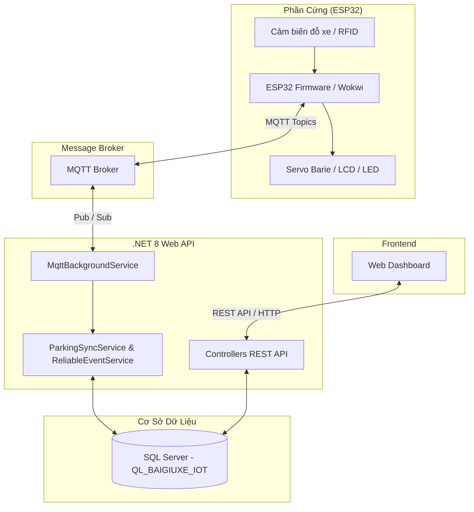

# Cấu Trúc Dự Án Hệ Thống IoT Smart Parking

Tài liệu này tổng hợp cấu trúc thư mục, chức năng của từng thành phần và luồng hoạt động của toàn bộ hệ thống Bãi Đỗ Xe Thông Minh (IoT Smart Parking).

---

## 1. Sơ Đồ Cây Thư Mục (Project Tree)

```text
E:\IOT\IOTCODE\
├── AGENTS.md                                   # Quy ước mã nguồn, phát triển và hướng dẫn cho AI/Contributor
├── PROJECT_STRUCTURE.md                        # Tài liệu mô tả cấu trúc dự án (file này)
└── IOT_SmartParking/                           # Thư mục gốc chứa toàn bộ mã nguồn hệ thống
    ├── .gitignore                              # Cấu hình bỏ qua các file build/tạm thời của Git
    ├── .vscode/                                # Cấu hình môi trường Visual Studio Code
    │   ├── extensions.json                     # Khuyến nghị extension (PlatformIO, C#, Wokwi, ...)
    │   └── settings.json                       # Thiết lập cấu hình IDE
    ├── diagram.json                            # Sơ đồ mạch điện và linh kiện mô phỏng Wokwi
    ├── wokwi.toml                              # Cấu hình khởi chạy giả lập Wokwi
    ├── platformio.ini                          # Cấu hình PlatformIO (board esp32dev, dependencies)
    ├── IOT_SmartParking_DoAnCuoiKy.code-workspace # File workspace mở nhanh trong VS Code
    ├── QL_BAIGIUXE_IOT.sql                     # Script khởi tạo cơ sở dữ liệu SQL Server
    ├── README.md                               # Hướng dẫn tổng quan dự án
    │
    ├── src/                                    # Mã nguồn C++ cho ESP32
    │   └── main.cpp                            # Logic chính của firmware ESP32 (cảm biến, servo, MQTT, WiFi, Deep Sleep)
    │
    ├── include/                                # Header files C++
    │   ├── ReliableMqtt.h                      # Cơ chế gửi nhận MQTT đảm bảo độ tin cậy (ACK, Retry, Outbox)
    │   └── README
    │
    ├── lib/                                    # Thư viện ngoài cho PlatformIO (nếu có)
    │   └── README
    │
    ├── test/                                   # Hướng dẫn và tài liệu kiểm thử
    │   └── README
    │
    ├── docs/                                   # Tài liệu kỹ thuật phần cứng & mạch điện
    │   ├── circuit-isolation.md                # Hướng dẫn cách ly mạch điện chống nhiễu
    │   └── power-and-sleep.md                  # Hướng dẫn cấp nguồn và chế độ Deep Sleep cho ESP32
    │
    ├── backend/                                # Backend REST API (.NET 8 Web API)
    │   ├── Program.cs                          # Entry point cấu hình DI, middleware, JWT, Swagger, MQTT
    │   ├── SmartParking.Api.csproj             # File dự án .NET 8 và các NuGet package
    │   ├── SmartParking.Api.http               # File test nhanh các endpoint API qua HTTP client
    │   ├── appsettings.json                    # Cấu hình chuỗi kết nối Database, MQTT broker, JWT secret
    │   ├── appsettings.Development.json        # Cấu hình môi trường Development
    │   ├── Configuration/                      # Các lớp map cấu hình từ appsettings
    │   │   ├── JwtSettings.cs                  # Cấu hình xác thực JWT (Key, Issuer, Audience, Expiry)
    │   │   └── MqttSettings.cs                 # Cấu hình MQTT Broker (Host, Port, ClientId, Topics)
    │   ├── Controllers/                        # Các API Controllers (RESTful endpoints)
    │   │   ├── AuthController.cs               # Đăng nhập, cấp phát token JWT & phân quyền RBAC
    │   │   ├── LichSuController.cs             # Truy vấn lịch sử cảm biến và sự kiện
    │   │   ├── PhienGuiXeController.cs         # Quản lý phiên gửi/trả xe (check-in, check-out, tính phí)
    │   │   ├── PhuongTienController.cs         # Quản lý thông tin phương tiện, biển số, thẻ RFID
    │   │   ├── ThongKeController.cs            # Thống kê doanh thu, lưu lượng xe, tỷ lệ lấp đầy bãi
    │   │   ├── ViTriDoXeController.cs          # Quản lý và giám sát trạng thái từng vị trí đỗ xe
    │   │   └── WeatherForecastController.cs    # Template mẫu mặc định của .NET
    │   ├── Data/                               # Tầng truy cập dữ liệu (EF Core / ADO.NET)
    │   │   ├── SmartParkingDbContext.cs        # DbContext chính quản lý các bảng trong SQL Server
    │   │   └── SmartParkingDbContext.Sync.cs   # Mở rộng DbContext hỗ trợ đồng bộ dữ liệu thời gian thực
    │   ├── Dtos/                               # Data Transfer Objects
    │   │   ├── AuthDtos.cs                     # DTO đăng nhập, thông tin tài khoản
    │   │   ├── MqttPayloadDtos.cs              # DTO gói tin JSON nhận/gửi qua MQTT
    │   │   └── ReliableEventDto.cs             # DTO cấu trúc sự kiện đảm bảo tính tin cậy
    │   ├── Models/                             # Entity Models (ánh xạ bảng cơ sở dữ liệu)
    │   │   ├── ChiTietViTriDo.cs               # Chi tiết lịch sử đỗ của từng vị trí
    │   │   ├── LichSuCamBien.cs                # Lưu log dữ liệu cảm biến đo được
    │   │   ├── MqttEventInbox.cs               # Bảng lưu trữ gói tin MQTT nhận (chống duplicate)
    │   │   ├── MqttReliableEvent.cs            # Quản lý trạng thái xác nhận sự kiện (ACK/Pending)
    │   │   ├── NhatKyHeThong.cs                # Log hành động và cảnh báo hệ thống
    │   │   ├── PhienGuiXe.cs                   # Thông tin phiên đỗ (giờ vào, giờ ra, số tiền, trạng thái)
    │   │   ├── PhuongTien.cs                   # Thông tin xe (biển số, loại xe, chủ xe)
    │   │   └── ViTriDoXe.cs                    # Danh mục vị trí đỗ (A1, A2, trạng thái Trống/Đã đỗ/Bảo trì)
    │   └── Services/                           # Tầng nghiệp vụ (Business Logic & Background Workers)
    │       ├── MqttBackgroundService.cs        # Service chạy nền kết nối MQTT Broker, lắng nghe telemetry
    │       ├── ParkingSyncService.cs           # Xử lý đồng bộ trạng thái bãi xe từ MQTT vào Database
    │       ├── ParkingSyncResult.cs            # Kết quả trả về của quá trình đồng bộ
    │       ├── ReliableEventService.cs         # Đảm bảo xử lý sự kiện chính xác, chống mất gói và xử lý lặp
    │       └── SnapshotAuditService.cs         # Kiểm toán đối soát snapshot trạng thái thực tế và database
    │
    └── dashboard/                              # Giao diện Web Frontend (SPA không dùng framework)
        ├── index.html                          # Trang giao diện chính (sơ đồ bãi đỗ, bảng điều khiển, thống kê)
        ├── style.css                           # Giao diện CSS hiện đại (responsive, grid/flexbox, dark/light theme)
        └── app.js                              # Xử lý logic frontend, gọi API backend, cập nhật giao diện thời gian thực
```

---

## 2. Chi Tiết Các Phân Hệ Chính

### A. Phân Hệ Thiết Bị & Firmware (`src/`, `include/`)
* **Nền tảng:** Vi điều khiển ESP32, framework Arduino biên dịch qua PlatformIO (`platformio.ini`).
* **Linh kiện điều khiển:**
  * Cảm biến siêu âm / khoảng cách / hồng ngoại phát hiện xe tại các vị trí đỗ và cổng vào/ra.
  * Động cơ Servo điều khiển thanh chắn Barie (mở khi quét hợp lệ, đóng khi xe qua).
  * Đầu đọc RFID nhận diện thẻ xe.
  * Màn hình LCD/OLED và đèn LED báo hiệu trạng thái (Xanh = Trống, Đỏ = Đã có xe).
* **Mô phỏng phần cứng:** Có thể chạy trực tiếp trên Wokwi thông qua cấu hình `diagram.json` và `wokwi.toml`.
* **Cơ chế truyền thông tin cậy:** `ReliableMqtt.h` cung cấp cơ chế Outbox, ACK và Retry để đảm bảo ESP32 không bị mất dữ liệu trạng thái khi kết nối mạng chập chờn.

### B. Phân Hệ Backend API (`backend/`)
* **Công nghệ:** C# .NET 8 Web API, Entity Framework Core kết nối Microsoft SQL Server.
* **Giao tiếp IoT (MQTT):**
  * `MqttBackgroundService` duy trì kết nối liên tục đến MQTT Broker.
  * Nhận dữ liệu trạng thái ô đỗ từ ESP32, giải mã DTO và bàn giao cho `ParkingSyncService`.
  * Gửi lệnh điều khiển (mở cổng Barie, đổi trạng thái) ngược lại cho ESP32.
* **Bảo mật & Phân quyền:**
  * JWT (JSON Web Token) xác thực người dùng.
  * Phân quyền Role-based Access Control (Admin, Nhân viên trực bãi).
* **Quản lý nghiệp vụ:**
  * Quản lý phiên gửi xe (`PhienGuiXe`), tính cước tự động dựa trên thời gian thực.
  * Quản lý xe ra vào, danh mục ô đỗ và bảng lịch sử cảm biến.

### C. Phân Hệ Cơ Sở Dữ Liệu (`QL_BAIGIUXE_IOT.sql`)
* **Hệ quản trị CSDL:** Microsoft SQL Server.
* **Các bảng chính:**
  * `ViTriDoXe`, `ChiTietViTriDo`: Trạng thái và tọa độ vị trí các ô đỗ.
  * `PhuongTien`, `PhienGuiXe`: Thông tin phương tiện và lịch sử gửi xe, cước phí.
  * `LichSuCamBien`: Lưu log dữ liệu cảm biến phục vụ thống kê phân tích.
  * `MqttEventInbox`, `MqttReliableEvent`: Bảng trung gian đảm bảo tính toàn vẹn (idempotency) của các sự kiện MQTT.
  * `NhatKyHeThong`: Nhật ký hệ thống ghi lại hành vi thao tác của người dùng và thiết bị.

### D. Phân Hệ Giao Diện Người Dùng (`dashboard/`)
* **Công nghệ:** HTML5, CSS3, Vanilla JavaScript (nhẹ, không cần cài đặt node_modules).
* **Tính năng:**
  * **Sơ đồ bãi xe trực quan:** Hiển thị trực tiếp các ô đỗ còn trống hoặc đã có xe theo thời gian thực.
  * **Quản trị ra/vào:** Xem biển số xe, thời gian check-in/check-out.
  * **Điều khiển thủ công:** Nút bấm khẩn cấp để mở/đóng thanh chắn Barie.
  * **Báo cáo & Thống kê:** Biểu đồ doanh thu và mật độ sử dụng bãi đỗ.

---

## 3. Luồng Trao Đổi Dữ Liệu (Data Flow)



---

## 4. Các Lệnh Thường Dùng Khi Phát Triển

Thực hiện từ thư mục `IOT_SmartParking/`:

| Tác vụ | Lệnh |
|---|---|
| **Build firmware ESP32** | `pio run` |
| **Nạp firmware lên ESP32** | `pio run -t upload` |
| **Mở Serial Monitor (115200)** | `pio device monitor` |
| **Khôi phục thư viện .NET** | `dotnet restore backend/SmartParking.Api.csproj` |
| **Biên dịch Backend API** | `dotnet build backend/SmartParking.Api.csproj` |
| **Chạy Backend API** | `dotnet run --project backend/SmartParking.Api.csproj` |
| **Chạy Web Dashboard** | Mở trực tiếp `dashboard/index.html` trên trình duyệt hoặc dùng Live Server / `npx serve dashboard` |
